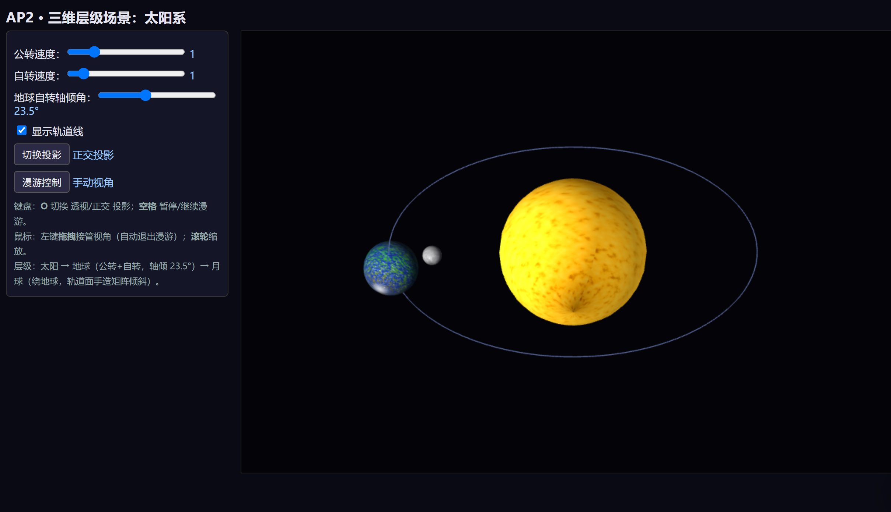
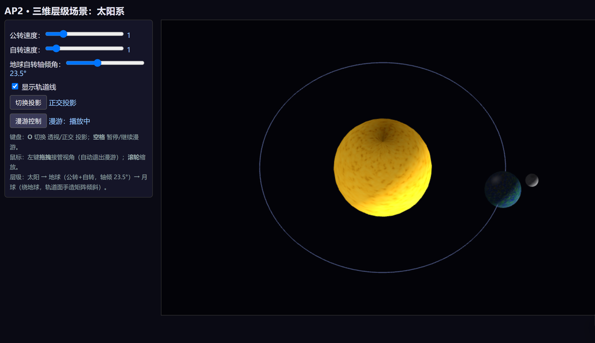
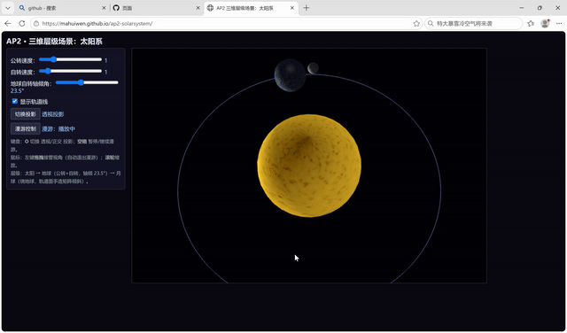

# AP2 · 三维层级场景：太阳系

> 课程：Interactive Computer Graphics（教材：Angel & Shreiner, 8th ed.，Ch4–5）
> 技术栈：原生 **WebGL 2.0** + JavaScript（ES Modules），教材配套 `Common/` 工具库（`initShaders.js` / `MV.js` / `webgl-utils.js`）
> 无构建步骤，任意静态服务器即可运行。

---

## 一、运行方式

项目为纯静态网页，**必须通过本地静态服务器打开**（`file://` 直接打开会因浏览器禁止本地模块读取而失效）。

```bash
# 方法 1：Python（推荐，无需安装额外工具）
cd D:\ap2-solarsystem
python -m http.server 8000
# 浏览器访问 http://localhost:8000/index.html

# 方法 2：VS Code 自带 Live Server 插件
# 右键 index.html → “Open with Live Server”
```

## 二、实现要点

### 2.1 层级结构（太阳 → 地球 → 月球）

模型矩阵逐层相乘表达“物体在物体之上”的变换依赖，维护在 `solar.js` 的 `buildScene()` 中：

```
太阳  M_sun   = R_y(太阳自转角) · S(sunRadius)                      （位于原点）

地球  M_earth = R_y(地球公转角) · T(3,0,0)                          ← 公转轨道（XZ 平面）
              · [ R_z(23.5°) · R_y(地球自转角) · S(earthRadius) ]   ← 自身模型（先自转再倾角）
      实现：“先在地球自身模型矩阵上施加倾角旋转，再叠加公转轨道变换” —— 体会变换顺序决定结构。

月球  M_moon  = R_y(地球公转角) · T(3,0,0)                          ← 随地球被搬运
              · R_x(月球轨道面倾角5°) · R_y(月球公转角) · T(0.75,0,0) ← 绕地球转（手造矩阵+倾角）
              · R_y(月球自转角≈公转角，潮汐锁定) · S(moonRadius)
```

变换嵌套树：

```
Scene
└─ Sun（位于原点，自转，缩放 1.2）
└─ Earth（R_y(公转)·T(3,0,0) 挂到公转轨道）
   └─ EarthSelf（R_z(23.5°倾角)·R_y(自转)·S(0.45)）
   └─ Moon（绕地球：R_x(5°轨道面倾角)·R_y(公转)·T(0.75,0,0)）
      └─ MoonSelf（R_y(自转)·S(0.16)）
```

### 2.2 手动矩阵（满足“不用复合函数”要求）

`MV.js` 中工具函数（如 `lookAt`/`perspective`）属于“封装好的复合函数”；本项目中**月球轨道面倾角**不调用任何封装函数，而是用 MV.js 的**基本变换** `rotate`/`translate` 手工 `mult` 组合而成，见 `solar.js` 的 `buildMoonOrbitMatrix()`：

```
flat  = R_y(angle) · T(r, 0, 0)      → 在水平 XZ 轨道平面上公转
orbit = R_x(inclination) · flat      → 把整个公转轨道面绕 X 轴倾斜 inclination 角度
```

构造逻辑（列主序，顶点被最左侧矩阵最后作用）：顶点先被 `T(r,0,0)` 平移到轨道半径处，再被 `R_y(angle)` 沿轨道公转（此时轨迹在水平面），最后被整体 `R_x(inclination)` 倾斜——于是月球在**相对黄道面倾斜 5° 的轨道面**上公转。这正体现教材 Ch4 的“变换顺序决定结构”。改变 `inclination` 即可调整轨道面倾角。

### 2.3 表面纹理（太阳/地球/月球各一张位图）

- 三张 PNG（`textures/` 目录）由 `make_textures.py` 程序化生成（太阳橙黄渐变+斑点、地球海洋大陆+云、月球灰基+环形山）。
- 加载使用 `gl.texImage2D` + 纹理坐标 `attribute aTexCoord`，片元着色器 `texture()` 采样。
- **地球纹理上下颠倒问题的处理**：`Image` 的首行是图片顶部，而 OpenGL 纹理坐标 v=0 默认对应图片**最后一行**（底部）。因此加载时设置 `gl.pixelStorei(gl.UNPACK_FLIP_Y_WEBGL, true)`，使 v=0 对应图片顶部；同时球体生成（`makeSphere`）令北极（phi=0）的 `v=0`、南极 v=1。三者对齐后纹理即正立不颠倒。若仍颠倒，可改为 `texV = 1 - phi/π`，或去掉 `UNPACK_FLIP_Y_WEBGL`。

### 2.4 双投影对比（按 `O` 切换）

- **透视投影** `perspective(45°, aspect, 0.1, 60)`：近大远小，平行线汇聚到消失点，符合人眼。
- **正交投影** `ortho(-w, w, -h, h, 0.1, 60)`：物体大小与距离无关，平行线保持平行。
- 同一场景、同一相机姿态下按 `O` 或点击“切换投影”按钮即可对比。

| 透视投影 | 正交投影 |
|---|---|
|  |  |

说明：透视图中远离相机的天体更小、近处更大；正交图中所有天体视觉大小不随距离变化，轨道圆的远近半弧看起来等大，平行轨道线永不相交。

### 2.5 相机漫游与鼠标接管

- 预设环绕路径为**关键帧插值**（`camera.js` 的 `TOUR_KEYS`，5 个关键帧对 theta/phi/radius 线性插值），环绕场景一周。
- **空格**：暂停 / 继续漫游（在手动视角下按空格则重新进入漫游）。
- **鼠标左键拖拽**：立即接管视角（自动退出漫游）；**滚轮**缩放（radius 3–18）。两者可随时互相接管。

### 2.6 参数面板

- 公转速度 / 自转速度 滑条：以倍率实时控制天体运动速度。
- 地球自转轴倾角 滑条：0–60°，实时改变 23.5° 倾角。
- “显示轨道线”勾选框：开关地球 / 月球轨道线。

### 2.7 漫游演示（10 秒关键帧环绕）



漫游为 5 个关键帧的线性插值环绕路径；按 `空格` 暂停 / 继续，鼠标左键拖拽可随时接管视角。

---

## 三、交互操作一览

| 操作 | 效果 |
|---|---|
| `O` 或“切换投影”按钮 | 透视 ⇄ 正交投影 |
| `空格` 或“漫游控制”按钮 | 暂停/继续漫游 |
| 鼠标左键拖拽 | 接管视角（方位角 / 仰角） |
| 鼠标滚轮 | 拉近 / 拉远 |
| 公转 / 自转滑条 | 调整天体运动速度 |
| 倾角滑条 | 调整地球自转轴倾角（默认 23.5°） |
| 轨道线勾选框 | 显示 / 隐藏轨道线 |

---

## 四、文件结构

```
ap2-solarsystem/
├── index.html          # 页面 + 参数面板 + 引入模块
├── main.js             # 初始化、纹理加载、渲染循环、鼠标交互
├── solar.js            # 天体参数集中配置、球体几何、层级建模、手造矩阵、轨道线
├── camera.js           # 相机、透视/正交投影、关键帧漫游
├── ui.js               # 参数面板绑定、键盘交互
├── shaders.js          # 主着色器（纹理×光照）、轨道线着色器
├── Common/
│   ├── initShaders.js  # 教材配套（编译着色器）
│   ├── MV.js           # 教材配套 3D 矩阵/向量库（列主序，含 lookAt/perspective/rotate…）
│   └── webgl-utils.js  # 教材配套
├── textures/           # sun.png / earth.png / moon.png（位图纹理）
├── make_textures.py    # 纹理生成脚本（可复现）
└── screenshot-*.png    # README 双投影对比截图
```

说明：`Common/` 目录三个库为教材配套源码；`MV.js` 在课程 2D 精简版基础上补齐了 AP2 所需的 3D 函数（`rotate`/`scalem`/`lookAt`/`perspective`/`ortho` 等），并修复了 `lookAt` 观察矩阵第三列的符号，保证深度方向正确（相机看向 `-z`）。

---

## 五、评分量规对照

- **层级与变换正确性**：太阳–地球–月球三级嵌套 ✓；地球倾角以“先自转后倾斜再挂公转”实现 ✓；月球轨道面倾角用手造矩阵（`buildMoonOrbitMatrix`）✓
- **观察与投影**：`O` 键双投影可切换且差异正确 ✓；漫游关键帧插值、空格可暂停 ✓
- **交互与面板**：公转/自转速度、轴倾角滑条、轨道线开关全部生效 ✓
- **代码质量**：天体参数（半径/距离/周期）集中配置于 `solar.js` 的 `BODIES` ✓
- **README 与演示**：本文件含变换嵌套树、手造矩阵说明、双投影对比截图 ✓
